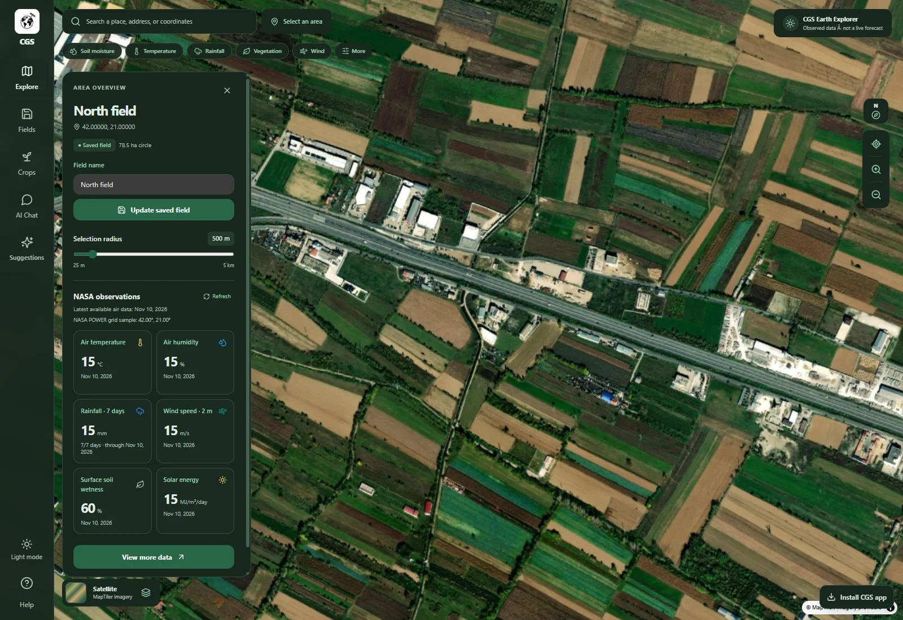
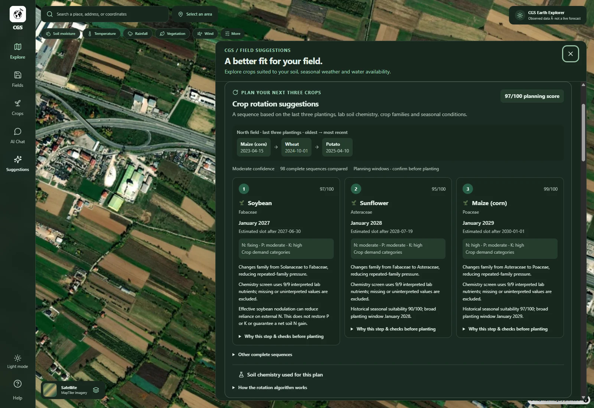
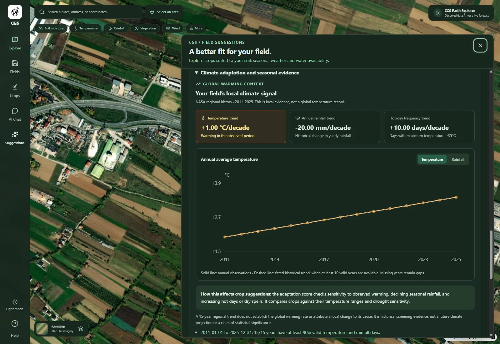

<div align="center">
  
  <h1>CeresGaiaSystems</h1>
  <p><strong>From Earth observation to better crop decisions.</strong></p>
  <p>Explore a field, understand its changing climate, and compare what to plant next.</p>
  <p>Next.js · React · TypeScript · NASA POWER · NASA GIBS · Installable PWA</p>
</div>

---

## The idea

Farmers make planting decisions across several different sources: weather forecasts, past crops, laboratory soil reports, and their own knowledge of the land. CGS brings these together around a saved field, with clear explanations of how each input affects a recommendation.

Built for the **NASA Space Apps Challenge**, CGS connects NASA Earth-observation data with practical crop planning. It is an explainable decision-support prototype: users can inspect the evidence, see what is missing, and keep their field records available offline.



*Interface preview with an isolated demo field and synthetic environmental/lab data. Screenshots illustrate the application; the running app retrieves environmental data from its configured providers.*

## What you can do

- **Explore and save fields.** Select a location, choose a radius, and keep separate records for multiple fields.
- **Understand field conditions.** View dated NASA observations, rainfall history, and temperature and soil-wetness trends.
- **Record crop history and soil tests.** Add planting dates, optional management details, and laboratory measurements.
- **Compare crop suitability.** Inspect scores, contributing factors, confidence, and reasons for each crop.
- **Plan crop rotations.** Compare sequences of three future crops against the last three recorded plantings and available soil/climate evidence.
- **See the local climate signal.** Explore historical temperature and rainfall graphs, fitted trends, hot days, and seasonal evidence.
- **Ask the field assistant.** Use optional Gemini-powered chat grounded in the selected field and available observations.
- **Install and work offline.** Reopen the app, edit saved records, and view previously downloaded data. Includes light and dark themes.

## How it works

1. **Select a field.** MapLibre displays MapTiler basemaps and search results. Saved fields receive unique IDs so their records remain separate.
2. **Retrieve evidence.** Next.js API routes request NASA observations and climate history, plus Meteomatics forecasts when configured.
3. **Analyze the history.** The app calculates monthly climate averages, rainfall variability, frost/hot-day counts, dry spells, and historical trends.
4. **Compare options.** Deterministic scoring combines environmental evidence with crop profiles, planting history, and optional lab results. AI chat is a separate feature.
5. **Explain and retain the results.** Reports show the factors behind each score and save previously loaded data for offline access.

### Data sources

| Source | Role in CGS |
| --- | --- |
| [NASA POWER](https://power.larc.nasa.gov/) | Regional modeled temperature, rainfall, humidity, wind, solar radiation, and surface soil wetness/moisture |
| [NASA GIBS](https://www.earthdata.nasa.gov/data/tools/gibs) | Dated map visualizations for vegetation, soil moisture, rainfall, surface temperature, and wind |
| [MapTiler](https://www.maptiler.com/) + [MapLibre](https://maplibre.org/) | Interactive basemaps, satellite imagery, and location search |
| [Meteomatics](https://www.meteomatics.com/en/weather-api/) | A 24-hour weather forecast sampled every three hours |
| Farmer-entered records | Crop history, planting dates, irrigation availability, root-zone moisture readings, and lab soil tests |
| FAO and extension references | Species growing ranges, water needs, salinity references, and qualitative nutrient-demand profiles |

NASA point queries use the selected coordinates, but the underlying information represents a regional grid—not measurements from a sensor inside the farm or an average over the selected circle. Soil wetness, volumetric moisture, historical observations, and forecasts retain distinct labels and dates.

## Explainable crop planning

The current catalog covers **wheat, maize, barley, soybean, sunflower, potato, and tomato**.

### Suitability scores

| Factor | Weight |
| --- | ---: |
| Historical climate fit | 20% |
| Climate adaptation sensitivity | 10% |
| Soil compatibility: pH and salinity | 15% |
| Measured N/P/K compatibility | 15% |
| Crop rotation | 20% |
| Rainfed water screening | 10% |
| Growing window, frost, and heat | 10% |

Unknown factors are excluded, and partial evidence reduces a factor’s effective weight. Scores are normalized over known evidence and displayed with coverage and confidence. Saving field details or a soil test updates suggestions automatically; the modal’s Refresh button retains unfinished form entries.

### Three-crop rotations

The rotation planner compares complete ordered sequences, with family breaks and non-overlapping tentative growing windows. It considers recent crop demand, seasonal suitability, and interpreted laboratory **N, P, K, Ca, Mg, S, Fe, Zn, and B** results when available. pH and salinity affect soil compatibility; organic matter is shown as context.

Crop profiles describe nutrient demand, not the amount of chemicals left in the soil. The planner does not invent harvest nutrient removal, simulate a measured nutrient balance, or assume that legumes restore phosphorus or potassium. See the [rotation algorithm notes](docs/crop-rotation.md) for the scoring policy and limitations.



*Demo data shown. Rotation cards explain the proposed order, crop families, nutrient-demand categories, and planning windows.*

### Climate evidence

The app requests the preceding **15 complete calendar years** of NASA POWER history. Monthly/yearly metrics require sufficient daily coverage; historical trend calculations require at least ten valid years. Missing values remain gaps.



*Demo data shown. The graph presents a local historical signal, not a global temperature record or a future climate projection.*

## Run locally

**Requirements:** Node.js 24+ and npm.

```bash
npm ci
```

Create `.env.local` from [.env.example](.env.example):

```powershell
# Windows PowerShell
Copy-Item .env.example .env.local
```

```bash
# macOS / Linux
cp .env.example .env.local
```

Configure the features you want to use:

| Environment variable | Purpose |
| --- | --- |
| `NEXT_PUBLIC_MAPTILER_KEY` | Maps, satellite basemap, and search |
| `METEOMATICS_USERNAME` / `METEOMATICS_PASSWORD` | Optional weather forecasts |
| `GEMINI_API_KEY` | Optional AI field assistant |
| `GEMINI_MODEL` | Optional model selection; see `.env.example` |

NASA POWER and GIBS require no API keys for the endpoints used here. The MapTiler key is browser-visible; restrict its allowed origins. Keep Meteomatics and Gemini credentials server-side and never commit `.env.local`. Restart the server after changing environment variables.

For development:

```bash
npm run dev
```

Open [localhost:3000](http://localhost:3000).

### Install the PWA

Offline support is enabled in the production build:

```bash
npm run build
npm start
```

Open the app online once and let offline preparation finish. Use **Install CGS app** when offered, or your browser’s Install/Add to Home Screen menu. On iPhone, use Safari → Share → Add to Home Screen.

Phone installation and offline support require an **HTTPS** deployment or testing address. An HTTP LAN address can preview the online site, but does not provide the required secure context for its service worker. Stop any development server using port 3000 before starting production on the same port.

## Storage and offline behavior

| Layer | What it holds |
| --- | --- |
| React Context | Current fields and shared field selection while the app is open |
| localStorage | Per-field geometry, crop records, soil tests, management, latest observation/forecast snapshots, and preferences |
| IndexedDB | Previously opened detailed history and generated recommendation/rotation reports |
| Service-worker cache | The application shell, scripts, styles, logo, and installation assets |
| Server cache | Reusable upstream responses, including successful climate-history chunks |

Offline users can edit saved records and view matching downloaded reports. **Maps, satellite imagery, search, AI chat, fresh data, and new recommendation calculations require internet.** Map tiles and imagery are not cached. An offline message explains the limits and offers **Never show again**.

The complete underlying 15-year NASA daily dataset is not downloaded to the user’s device; the report retains its climate summaries. Records are local to the browser/device and website origin, including its port. There is no account-based cloud sync or backup, and clearing site data can remove saved records. Using AI chat sends the selected field context and conversation to Google.

More detail: [offline and installation notes](docs/offline.md).

## Project structure

```text
app/                  Pages, PWA manifest, and server API routes
components/           Map, field editors, suggestions, graphs, and chat
lib/                  Climate analysis, scoring, rotations, validation, and storage
lib/data/             Versioned crop agronomy profiles
public/               Logo, favicon, and PWA installation icons
scripts/              Production service-worker generation and documentation capture
tests/                Algorithm, API parsing, storage-flow, and browser checks
docs/                 Technical notes and README screenshots
```

## Validation

```bash
npm run typecheck
node --test tests/*.test.mjs
npm run build
```

For the isolated Chrome browser checks, first start a production server, then run:

```bash
node tests/pwa-browser.mjs http://localhost:3000
```

The browser test uses a temporary profile and synthetic API fixtures, preserving personal browser records. It expects Chrome on Windows by default; `CHROME_PATH` can override the executable path.

## Scope and limitations

CGS is a hackathon prototype for comparing options—not a validated yield predictor or fertilizer/irrigation prescription. Crop ranges are broad species references; cultivar, actual harvest, local disease history, root-zone water, and laboratory calibration still matter. NASA availability and provider quotas can limit results. Missing or stale evidence is disclosed rather than replaced with fabricated values.

Built with NASA Earth data and the agricultural references linked in each report. Independent project; no NASA endorsement is implied.
